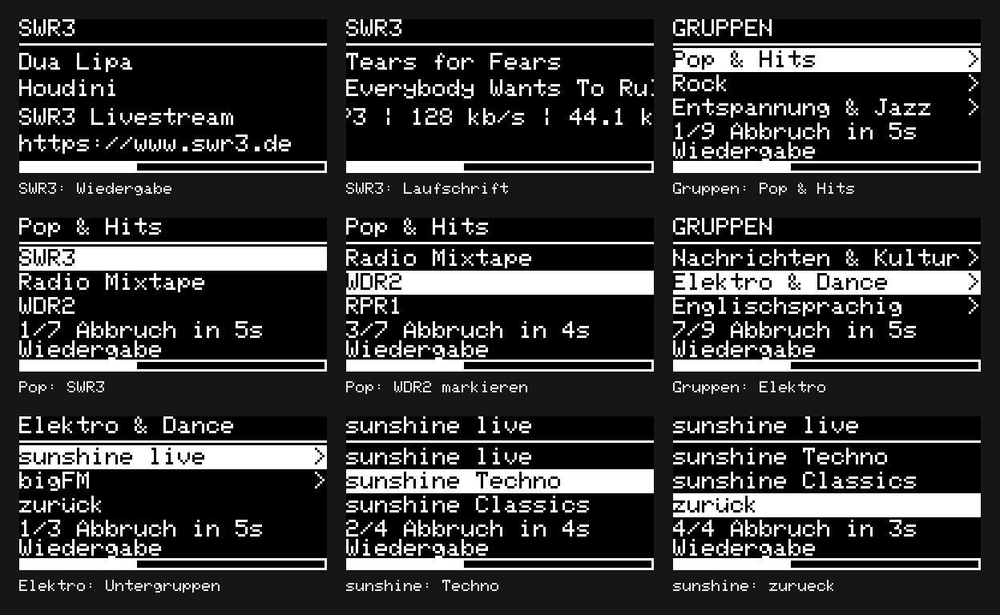

# ESP32 Webradio

Modularer Arduino-Sketch fuer einen klassischen Dual-Core ESP32 (WROOM/DevKit oder WROVER) mit einem MAX98357A fuer Mono oder zwei MAX98357A fuer Stereo und 128x64-I2C-OLED. Kein ESP32-C3/S2. Die Pinbelegung ist fuer einen klassischen ESP32 vorgesehen.

## Einrichtung

1. In `Config.h` WLAN-Name und Passwort eintragen.
2. Displaycontroller pruefen: `OLED_SH1106 = true` fuer SH1106, `false` fuer SSD1306. Defaultadresse 0x3C, alternativ oft 0x3D. Die Diagonale allein legt den Controller nicht fest.
3. Die Standard-Senderliste und der Gruppenbaum stehen in `Stations.h`. Nach dem Hochladen kannst du Sender im Webinterface hinzufuegen, bearbeiten, loeschen, Gruppen zuordnen und sortieren. Auch Gruppen, Untergruppen und der Hostname sind dort bearbeitbar. Die im Webinterface gespeicherte Liste hat Vorrang vor der Standardliste. Direkte MP3/AAC-Streams bevorzugen; M3U/PLS werden von der Audiobibliothek aufgeloest.
4. Bibliotheken: Ai Esp32 Rotary Encoder 1.7, Adafruit GFX, Adafruit SH110X, Adafruit SSD1306 und Adafruit BusIO. Beide Displaybibliotheken werden zum Kompilieren benoetigt.
5. **ESP32-audioI2S Version 3.0.12** von https://github.com/schreibfaul1/ESP32-audioI2S/releases/tag/3.0.12 installieren (Arduino IDE: ZIP-Bibliothek hinzufuegen). Die neueste Version ist kein kompatibler Ersatz fuer diese Konfiguration. Fuer den lokalen CLI-Build liegt die Version unter `.build-deps/ESP32-audioI2S-3.0.12`.
6. Board `ESP32 Dev Module`, Flash mindestens 4 MB, Partition `Huge APP (3MB No OTA/1MB SPIFFS)`. PSRAM bei WROVER aktivieren; fuer einfache MP3-Streams ist es bei dieser Bibliotheksversion nicht zwingend notwendig.
7. In `Config.h` den Audiomodus mit `AUDIO_MONO` waehlen (siehe unten), danach neu kompilieren und auf den ESP32 hochladen.

CLI im Projektordner:

```powershell
arduino-cli compile --fqbn esp32:esp32:esp32:PartitionScheme=huge_app --libraries .build-deps --build-path .build .
```

## Mono / Stereo

Der Audiomodus wird beim Kompilieren in `Config.h` festgelegt:

| Einstellung | Ausgabe | Hardware |
|---|---|---|
| `AUDIO_MONO = true` (Standard) | Linker und rechter Kanal werden zu Mono gemischt | Ein MAX98357A mit einem Lautsprecher |
| `AUDIO_MONO = false` | Linker und rechter Kanal bleiben getrennt | Zwei MAX98357A mit je einem Lautsprecher |

`RadioAudio` uebergibt die Einstellung an `audio.forceMono(...)`. Da ESP32-audioI2S 3.0.12 diesen Schalter intern nicht auf die Samples anwendet, uebernimmt der Sketch die Monomischung fuer 16-Bit-Stereodaten (MP3/AAC) im Callback `audio_process_i2s`. Dabei wird `(L + R) / 2` mit einem 32-Bit-Zwischenwert berechnet und auf beide I2S-Kanaele geschrieben. Im Stereobetrieb bleiben die Samples unveraendert. Im Stereobetrieb werden die Verstaerker ueber SD/MODE fest auf links bzw. rechts eingestellt; die Software benoetigt dafuer keine weiteren GPIOs. Ein Mono-Stream wird von der Audiobibliothek auch im Stereobetrieb auf beiden Kanaelen ausgegeben. Die Auswahl erfolgt ausschliesslich in `Config.h`, nicht ueber den Encoder oder NVS.

## Verdrahtung

| Bauteil | Anschluss | ESP32 |
|---|---|---|
| OLED | SDA | GPIO21 |
| OLED | SCL | GPIO22 |
| OLED | VCC / GND | 3.3V / GND |
| Encoder | CLK / A | GPIO32 |
| Encoder | DT / B | GPIO33 |
| Encoder | SW | GPIO27 |
| Encoder | + / GND | 3.3V / GND |
| MAX98357A (bei Stereo beide) | BCLK | GPIO26 |
| MAX98357A (bei Stereo beide) | LRC / WS | GPIO25 |
| MAX98357A (bei Stereo beide) | DIN | GPIO23 |
| MAX98357A (bei Stereo beide) | VIN / GND | 5V / GND |

Alle Massen verbinden. Encoderkontakte schalten gegen GND, interne Pull-ups sind aktiviert. Bei umgekehrter Drehrichtung A/B tauschen; bei falscher Anzahl Schritte `ENCODER_STEPS` anpassen (typisch 4 oder 2). Keine 5V-Signale auf ESP32-GPIOs.

MAX98357A SD/EN muss entsprechend dem verwendeten Breakout aktiviert sein; bei einem Breakout ohne vorhandenen Pull-up gemaess dessen Datenblatt beschalten. Lautsprecher ausschliesslich zwischen SPK+ und SPK- des jeweiligen Verstaerkers anschliessen. Keinen Lautsprecheranschluss mit GND oder einem Ausgang des anderen Verstaerkers verbinden. Versorgung fuer ESP32 und bei Stereo beide Verstaerker ausreichend dimensionieren.

### Zweiter Verstaerker fuer Stereo

BCLK, LRC/WS und DIN des zweiten MAX98357A werden parallel zum ersten an dieselben ESP32-Pins angeschlossen, ebenso VIN an 5V und GND an die gemeinsame Masse. Jeder Verstaerker erhaelt einen eigenen Lautsprecher. Beide Verstaerker sollten die gleiche GAIN-Beschaltung haben.

SD/MODE (oft mit SD oder EN beschriftet) bestimmt den ausgegebenen Kanal. Die folgenden Bereiche sind typische Schaltschwellen; Pegel mit Abstand zu den Grenzen waehlen:

| Verstaerker | SD/MODE-Pegel | Lautsprecher |
|---|---|---|
| Erster: links | Ueber 1,4 V, z. B. SD an 3.3V | Linker Lautsprecher an dessen SPK+ / SPK- |
| Zweiter: rechts | Zwischen 0,77 V und 1,4 V, Ziel ca. 1,0 V | Rechter Lautsprecher an dessen SPK+ / SPK- |

Bei 0,16 bis 0,77 V gibt der MAX98357A die Monomischung aus; SD an GND schaltet ihn ab. Zwei unveraendert auf Monomischung eingestellte Breakouts ergeben auch mit `AUDIO_MONO = false` keine Kanaltrennung.

Die Widerstandswerte fuer SD/MODE haengen von der Breakout-Beschaltung ab. Der Chip besitzt einen internen 100-kOhm-Pulldown; beim Adafruit-Mono-Breakout kommt ein 1-MOhm-Pull-up nach VIN hinzu. Fuer dessen rechten Kanal kann bei 5V-Versorgung ein zusaetzlicher 330-kOhm-Widerstand von SD nach 3.3V verwendet werden (rechnerisch ca. 1,07 V mit den genannten Widerstaenden). Bei anderen Modulen die vorhandenen Widerstaende und Loetbruecken pruefen und den SD-Pegel messen. SD-Pins fuer links und rechts getrennt beschalten.

Details zur Kanalwahl: [Adafruit MAX98357A Pinbelegung](https://learn.adafruit.com/adafruit-max98357-i2s-class-d-mono-amp/pinouts) und [MAX98357A/B-Datenblatt](https://www.analog.com/media/en/technical-documentation/data-sheets/MAX98357A-MAX98357B.pdf).

## Bedienung

- Drehen: Lautstaerke 0 bis 21, ohne Beschleunigung.
- Einmal klicken (loslassen): Gruppen-Uebersicht oeffnen; aktueller Sender laeuft weiter.
- Drehen: Gruppe, Untergruppe, Sender oder den letzten Eintrag `zurueck` markieren. Jede Ebene laeuft zyklisch.
- Gruppe anklicken: Untergruppen oder Sender dieser Gruppe oeffnen.
- Sender anklicken: Sender starten, Auswahl speichern und zur Lautstaerke zurueckkehren.
- Letzter Eintrag `zurueck`: genau eine Ebene hoeher. Die verlassene Gruppe bleibt dort markiert. In der Gruppen-Uebersicht schliesst `zurueck` die Auswahl und fuehrt zur Lautstaerke.
- 5 Sekunden ohne Drehung/Klick: Auswahl verwerfen, zur Lautstaerke zurueckkehren.

Die letzte Drehung oder der letzte Klick startet die Frist neu. WLAN und Streams werden bei Abbruch erneut verbunden. Das Display zeigt im Menue den Gruppennamen, bis zu drei Eintraege mit hervorgehobener Auswahl, Pfeile an Gruppen, Auswahlposition und Abbruch-Countdown. Die Wiedergabeansicht beginnt direkt mit dem gewaehlten Sendernamen, ohne WEBRADIO-Kopfzeile. Darunter stehen Interpret und Titel aus ICY-StreamTitle oder ID3; lange Zeilen laufen horizontal durch. ICY liefert nur Freitext: Bei ` - ` wird dieser auf zwei Zeilen verteilt, in der vom Sender gelieferten Reihenfolge. Ohne Trennzeichen bleibt der vollstaendige Text in einer Laufzeile. Ohne Titelmetadaten erscheint `Keine Titelinfos`. Weitere verfuegbare Textinfos (z. B. Album/Jahr/Genre aus ID3, Senderbeschreibung, abweichender Stream-Sendername, Homepage) wechseln auf den naechsten beiden Zeilen, zusammen mit Codec, Bitrate, Abtastrate und Kanalzahl. Jede Infoseite bleibt mindestens vier Sekunden und bei langen Texten bis zum Ende der Laufschrift sichtbar. Verbindungsprobleme erscheinen oberhalb des Balkens; waehrend regulaerer Wiedergabe ist dort Platz fuer Metadaten. Die Lautstaerke wird ausschliesslich als Balken am unteren Displayrand dargestellt, auch im Menue. Bestaetigter Sender und Lautstaerke werden im internen NVS-Flash gespeichert und beim Neustart wiederhergestellt. Senderbestaetigungen speichern sofort, Lautstaerkeaenderungen nach 2 Sekunden ohne weitere Drehung; vor Ablauf dieser Frist kann bei Stromausfall die letzte Aenderung verloren gehen. Eine unbestaetigte Senderauswahl wird nicht gespeichert. Ohne gespeicherte Werte gelten Sender 1 und Lautstaerke 8. Ungueltige gespeicherte Werte fallen auf diese Standardwerte zurueck. Die Senderauswahl verwendet eine feste Sender-ID und bleibt beim Umordnen erhalten. Bestehende gespeicherte Senderpositionen werden beim ersten Start uebernommen. Wird der laufende Sender geloescht, startet der erste Sender der neuen Liste.

## OLED-Demo-Screenshots

Die Bilder werden direkt aus `RadioDisplay.cpp`, der echten Menue-Navigation in `StationMenu.h` und der installierten Adafruit-GFX-Bibliothek mit deren Originalschrift gerendert. Verwendet wird die Standard-Sender- und Gruppenliste aus `Stations.h`. **Musik- und Streamangaben fuer SWR3 sind Demo-Daten**; die Bilder sind keine Aufzeichnung eines laufenden Streams und keine Fotos der Hardware. Die 128x64-Displaypixel sind ohne Glaettung vergroessert.



| Ansicht | Einzelbild und Bedienung |
|---|---|
| SWR3-Wiedergabe | [SWR3 mit Demo-Interpret Dua Lipa / Houdini](docs/images/oled/01-swr3-wiedergabe.png), Beschreibung, Homepage und Lautstaerkebalken. |
| Laufschrift und Infos | [SWR3 mit langem Demo-Titel von Tears for Fears](docs/images/oled/02-swr3-laufschrift.png); Momentaufnahme der Laufschrift und der wechselnden Streaminfos. |
| Gruppen oeffnen | [Gruppen-Uebersicht](docs/images/oled/03-gruppen-pop.png): Encoder klicken, `Pop & Hits` markieren. |
| Sendergruppe oeffnen | [Pop & Hits mit SWR3](docs/images/oled/04-pop-swr3.png): Gruppe anklicken, Senderliste anzeigen. |
| Durch Sender drehen | [WDR2 markieren](docs/images/oled/05-pop-wdr2.png): Das Listenfenster folgt der Auswahl. SWR3 laeuft bis zur Senderbestaetigung weiter. |
| Andere Gruppe waehlen | [Elektro & Dance markieren](docs/images/oled/06-gruppen-elektro.png): Ueber `zurueck` zur Gruppen-Uebersicht gehen und weiterdrehen. |
| Untergruppen anzeigen | [Elektro & Dance oeffnen](docs/images/oled/07-elektro-untergruppen.png): `sunshine live` und `bigFM` erscheinen. |
| Untergruppe durchblaettern | [sunshine Techno markieren](docs/images/oled/08-sunshine-techno.png): `sunshine live` oeffnen und zum Sender drehen. |
| Eine Ebene zurueck | [zurueck markieren](docs/images/oled/09-sunshine-zurueck.png): Nach dem Klick erscheint wieder das Elektro-Menue mit `sunshine live` markiert. |

Die Musik laeuft waehrend der Menue-Navigation weiter. Auswahlposition, Abbruch-Countdown, Wiedergabestatus und Lautstaerkebalken stammen aus dem Displaycode. Die Bilder liegen unter [`docs/images/oled/`](docs/images/oled/); dort gibt es auch unvergroesserte [128x64-PNGs](docs/images/oled/native/). Das [Manifest](docs/images/oled/manifest.json) enthaelt die Pruefsummen der verwendeten Quelltexte und Grafikbibliothek.

Nach Display- oder Menueaenderungen lassen sich alle Bilder ohne Hardware und ohne Netzwerk erneut erzeugen:

```bash
python3 tools/render_oled_demos.py
# Bei abweichender Bibliotheksinstallation:
python3 tools/render_oled_demos.py --gfx-library /pfad/zur/Adafruit_GFX_Library
```

Benoetigt werden Python 3, `g++` und die bereits verwendete Adafruit-GFX-Bibliothek; zusaetzliche Python-Pakete sind nicht erforderlich.

## Senderverwaltung im Browser

Nach dem Hochladen im selben WLAN zunaechst `http://webradio.local` oeffnen; nach einer Hostnamen-Aenderung entsprechend `http://<hostname>.local`. Falls das Geraet mDNS nicht unterstuetzt, die ESP32-IP aus der Router-Geraeteliste oder dem seriellen Monitor (115200 Baud) verwenden: `http://<IP-Adresse>/`. Der Webserver laeuft auf Port 80; WLAN-Daten werden weiterhin in `Config.h` eingetragen.

- **Sender hinzufuegen:** Name, HTTP(S)-Stream-URL, vorhandene Gruppe und Position eintragen, dann **Uebernehmen**.
- **Bearbeiten:** Name, URL, Gruppe oder Listenposition aendern. Auch die Untergruppen sunshine live und bigFM stehen zur Auswahl; Startseite bedeutet direkt in der Gruppen-Uebersicht.
- **Loeschen:** Ueber **Bearbeiten > Sender loeschen**, mit Rueckfrage. Mindestens ein Sender bleibt erhalten.
- **Sortieren:** Mit den grossen Pfeiltasten oder direkt ueber die Positionsnummer im Bearbeitungsfenster. Bei aktiven Filtern tauschen die Pfeile die Positionen benachbarter sichtbarer Sender. Die Reihenfolge wird auch im Drehencoder-Menue innerhalb jeder Gruppe verwendet; Untergruppen erscheinen weiterhin vor Sendern.
- **Suchen und filtern:** Sendername suchen oder eine Gruppe auswaehlen. Auf Smartphones passen sich Karten, Formulare und Speicherleiste an den Bildschirm an.
- **Aenderungen speichern:** Erst dieser Knopf schreibt Sender, Gruppen und Hostname gemeinsam dauerhaft in NVS-Flash. **Neu laden** verwirft nach Rueckfrage lokale Aenderungen. Beim Verlassen mit ungespeicherten Aenderungen warnt der Browser, soweit unterstuetzt.

Sender- und Gruppenaenderungen gelten sofort ohne Neustart. Beim Speichern wird ein geoeffnetes Encoder-Menue geschlossen. Der aktuelle Sender bleibt ueber seine feste ID erhalten; reine Sortier-, Namens- oder Gruppenaenderungen starten den Stream nicht neu. Eine geaenderte URL oder das Loeschen des laufenden Senders fuehrt zu einer neuen Verbindung. Die Audiotask erhaelt URL und Sender-ID als feste Kopie.

Grenzen: 1 bis 48 Sender, 1 bis 24 Gruppen einschliesslich Startseite, Sender-/Gruppenname maximal 63 UTF-8-Bytes, URL maximal 255 ASCII-Bytes, Hostname maximal 31 ASCII-Zeichen und gesamte gespeicherte Konfiguration maximal 8192 Bytes. Umlaute brauchen jeweils zwei UTF-8-Bytes. Namen werden fuer das OLED in CP437 umgesetzt; dort nicht vorhandene Zeichen erscheinen als `?`. Die Standard-Sender und -Gruppen werden nur ohne gueltige gespeicherte Konfiguration geladen. Aenderungen an `Stations.h` ueberschreiben eine bereits gespeicherte Webkonfiguration nicht. Bisherige Weblisten ohne Gruppen-/Hostnamenfelder werden automatisch mit den Standardgruppen und `webradio` ergaenzt; bearbeitete Sender bleiben dabei erhalten.

Ungueltige Eingaben und fehlgeschlagene Flash-Schreibzugriffe lassen die aktive Liste unveraendert. Eine Versionspruefung verhindert das Ueberschreiben durch veraltete Browserfenster; dann die Liste neu laden. Bei Verbindungsabbruch waehrend des Speicherns kann die Antwort fehlen, obwohl der Schreibvorgang erfolgreich war; die Liste erneut laden und pruefen. Die Oberflaeche wird vollstaendig vom ESP32 ausgeliefert und benoetigt keine externen Skripte, Schriftarten oder Cloud-Dienste.

### Gruppen und Untergruppen bearbeiten

**Gruppen verwalten** oeffnet die Gruppenliste. Dort sind neue Gruppen, Umbenennen, Aendern der uebergeordneten Gruppe, direkte Positionseingabe sowie Pfeile zum Sortieren verfuegbar. Die Listenreihenfolge bestimmt die Reihenfolge der Geschwistergruppen im Drehencoder-Menue. Vollstaendige Gruppenpfade erscheinen in den Auswahlfeldern, auch bei tiefer verschachtelten Untergruppen. Die Startseite (ID 0) kann umbenannt werden, bleibt aber als erste Wurzel ohne uebergeordnete Gruppe erhalten.

**Gruppe loeschen** fragt nach und verschiebt die direkt enthaltenen Sender und Untergruppen zur uebergeordneten Gruppe. Weitere Zuordnungen innerhalb der Untergruppen bleiben erhalten. Die Rueckfrage nennt Ziel und Anzahl der betroffenen Eintraege. Fehlende Eltern, Zuordnung zu sich selbst, Kreisbeziehungen, doppelte IDs und Sender in nicht vorhandenen Gruppen werden vom ESP32 abgewiesen. Die Oberflaeche bietet eigene Untergruppen nicht als Eltern an. Erst **Aenderungen speichern** uebernimmt die neue Struktur dauerhaft; **Fertig** schliesst nur die Gruppenverwaltung.

### Hostname bearbeiten

Die Karte mit der `.local`-Adresse oeffnet **Hostname bearbeiten**. Den Namen ohne `http://` und ohne `.local` eingeben, z. B. `radio-kueche`. Erlaubt sind 1 bis 31 Zeichen aus `a-z`, Ziffern und Bindestrichen innerhalb des Namens. Grossbuchstaben werden in Kleinbuchstaben umgewandelt. Die Laengengrenze passt zum Hostnamenpuffer von Arduino-ESP32 3.3.12.

Nach **Uebernehmen** bleibt die Aenderung zunaechst lokal. Der globale Knopf heisst dann ausdruecklich **Speichern & neu starten**. Er speichert die komplette Konfiguration und startet das Radio etwa 1,5 Sekunden nach dem erfolgreichen Commit neu. Die Wiedergabe wird kurz unterbrochen. Nach der Antwort zeigt die Oberflaeche einen Link zur neuen Adresse und zusaetzlich die bisherige IP-Adresse als Alternative; im Router oder seriellen Monitor ist die aktuelle IP zu finden. Bei einem Schreibfehler wird kein Neustart ausgeloest.

Der neue Name wird vor dem WLAN-Start gesetzt und anschliessend auch fuer mDNS verwendet. Gruppen- und Senderaenderungen allein loesen keinen Neustart aus. Technischer Hintergrund: [Espressif Wi-Fi-API: Hostname vor dem WLAN-Start setzen](https://docs.espressif.com/projects/arduino-esp32/en/latest/api/wifi.html).

Der Zugriff erfolgt ohne Login im lokalen WLAN. Schreibanfragen brauchen einen vom Radio gelieferten Sitzungstoken; es werden keine CORS-Freigaben erteilt. Die Senderverwaltung ist fuer ein vertrauenswuerdiges Heimnetz vorgesehen.

Technischer Hintergrund zur Persistenz: [Espressif NVS-Dokumentation](https://docs.espressif.com/projects/esp-idf/en/v5.5/esp32/api-reference/storage/nvs_flash.html). Der Listenspeicher verwendet einen einzelnen NVS-Blob und aktiviert neue Daten erst nach erfolgreichem Schreiben.

## Module

| Datei | Aufgabe |
|---|---|
| ESP32_Webradio.ino | Einstieg |
| Config.h | Zugangsdaten, Pins, Displaytyp, Mono-/Stereomodus, Zeitwerte |
| Stations.h | Standard-Senderliste und Gruppenbaum |
| StationStore.* | Sender, Gruppen und Hostname, stabile IDs, Validierung und gemeinsame NVS-Persistenz |
| RadioWeb.* | Lokaler HTTP-Server, API, mDNS und angekuendigter Neustart bei Hostnamenwechsel |
| WebPage.h | Responsive Browser-Oberflaeche ohne externe Abhaengigkeiten |
| OledText.h | UTF-8-Sendernamen fuer die CP437-Schrift des OLED |
| StationMenu.h | Navigation durch Gruppen, Untergruppen, Sender und zurueck |
| EncoderInput.* | ai-esp32-rotary-encoder, Interrupt, Wertebereiche |
| RadioNetwork.h | WLAN-Verbindung und Wiederverbindung |
| RadioAudio.* | Audio in eigener Task, Befehlsqueue und Stream-Wiederverbindung |
| RadioDisplay.* | OLED-Darstellung |
| RadioApp.* | Bedienzustand, Bestaetigung und Timeout |

Audio wird ausschliesslich von einer Task angesprochen. Die Queue enthaelt immer den neuesten vollstaendigen Sollzustand (Sender und Lautstaerke). Dadurch koennen blockierende Stream-Verbindungen die Bedienung nicht anhalten. Netzwerkverbindungen haben begrenzte Timeouts. Displayuebertragungen sind auf maximal 20 Hz begrenzt. Metadaten werden als feste Kopie ueber eine separate FreeRTOS-Queue an die Oberflaeche uebergeben. Ein Mutex schuetzt gemeinsame Metadaten auch bei Callbacks aus der separaten Decoder-Task der Audiobibliothek. Beim Senderwechsel, Verbindungsverlust und jedem neuen Verbindungsversuch werden sie geloescht. Textpuffer sind begrenzt (Interpret 191, Titel/Beschreibung 255, Homepage 191 Zeichen, bis zu acht weitere ID3-Felder mit je 159 Zeichen); laengere Angaben werden gekuerzt. UTF-8 und Latin-1 werden fuer den CP437-Displayfont umgesetzt, einschliesslich Umlauten; nicht darstellbare Zeichen erscheinen als Fragezeichen. Die Bibliothek 3.0.12 stellt ICY-Genre nicht bereit; angezeigt werden nur die von ihren Callbacks und Audioparametern verfuegbaren Angaben.

## Hardwarepruefung

Nach Eintragen der WLAN-Daten pruefen: Start und Wiedergabe, Lautstaerkegrenzen, Gruppen-Uebersicht, Untergruppen unter Elektro & Dance, `zurueck` auf jeder Ebene, Listenumsprung einschliesslich `zurueck`, Senderauswahl ohne sofortige Umschaltung, Bestaetigung, Abbruch nach 5 Sekunden, Neustart der Frist durch Drehen, Listenumsprung und Wiederverbindung nach WLAN-Ausfall. Zusaetzlich Mono mit einem Stereo-Testsignal pruefen: Sowohl ein nur links als auch ein nur rechts vorhandenes Signal muss aus dem einzelnen Lautsprecher hoerbar sein. Fuer Stereo `AUDIO_MONO = false` setzen, neu hochladen und mit einem Links-/Rechts-Testsignal pruefen, dass jeder Lautsprecher nur seinen Kanal wiedergibt. Ein erfolgreicher Build ersetzt diesen Test am angeschlossenen Geraet nicht.

## Bisherige Validierung

Die Bedienlogik aus `RadioApp.cpp` wurde auf dem PC mit simuliertem Encoder, Audio und Zeitgeber geprueft: Lautstaerke, Vorschau ohne Umschaltung, Bestaetigung, Timeout exakt bei 5000 ms, Fristneustart durch Drehen und millis()-Ueberlauf. Alle diese Pruefungen bestanden. Das prueft die Zustandslogik, nicht die realen Treiber oder Hardware.

Auch die Tastenentprellung wurde am PC geprueft: Prellen, langes Gedrueckthalten und genau ein Klick beim Loslassen bestanden.
Der vollstaendige ESP32-Build mit Arduino-ESP32 3.3.8 und Partition huge_app bestand: 1.358.904 Byte Flash (43%), 51.736 Byte statischer RAM (15%). Dynamischer Speicher fuer Audio/WLAN kommt zur Laufzeit hinzu. Ein Hardwaretest wurde nicht durchgefuehrt.

Mono und Stereo wurden am 19.10.2026 mit `AUDIO_MONO = true` bzw. `false`, Arduino-ESP32 3.3.12, ESP32-audioI2S 3.0.12 und Partition huge_app jeweils erfolgreich fuer den ESP32 kompiliert. Der finale Sketch enthaelt den Audio-Callback fuer die Monomischung. Dessen Verarbeitung wurde auf dem PC fuer beide Modi mit Links-/Rechts-Signalen, Gegenphase, maximalen positiven und negativen 16-Bit-Samples, unveraenderter Stereoausgabe sowie Puffergrenzen erfolgreich geprueft (mit UndefinedBehaviorSanitizer). Kanaltrennung und Wiedergabe an den Verstaerkern wurden nicht an Hardware getestet.

Die neue Gruppenauswahl wurde am 19.10.2026 mit der aktuellen App- und Menue-Logik auf dem PC (UndefinedBehaviorSanitizer) geprueft: alle 11 Menueebenen und 29 Senderpfade, Zurueck-Navigation mit Gruppenmarkierung, Encodergrenzen und Listenumsprung, keine Audioumschaltung beim Navigieren, Senderbestaetigung und NVS-Wiederherstellung, Timeout exakt bei 5000 ms, Fristneustart durch Drehen/Klicken, millis()-Ueberlauf und gleichzeitiges Drehen/Klicken. Alle Pruefungen und der vollstaendige ESP32-Build (huge_app, bestehende lokale Bibliotheken) bestanden. Ein Hardwaretest der Gruppenauswahl steht aus. Testdateien: `.build-tests/groups/`.

Die Metadatenanzeige wurde am 19.10.2026 auf dem PC mit AddressSanitizer und UndefinedBehaviorSanitizer geprueft: ICY/ID3, UTF-8/Latin-1 und Umlaute, 5000 zufaellige Texte und Puffergrenzen, Metadatenkopien, Sender-ID/URL-Wechsel, Lautstaerkeaenderungen ohne Neuverbindung, Loeschen alter Infos bei WLAN-Ausfall und Wiederverbindung, Displayzeilen ohne Ueberlappung mit dem unteren Lautstaerkebalken, Laufschrift, wechselnde Infoseiten und millis()-Ueberlauf. Der vollstaendige ESP32-Build (huge_app, lokale Bibliotheken) bestand ebenfalls. Die Wiedergabe und Anzeige realer Stream-Metadaten am OLED wurden nicht an Hardware geprueft. Testdateien: `.build-tests/metadata/`.

Die finale Metadatenanzeige wurde zusaetzlich mit gleichzeitig laufenden Titel- und Beschreibungs-/ID3-Callbacks auf zwei PC-Threads (je 2000 Durchlaeufe, AddressSanitizer und UndefinedBehaviorSanitizer) geprueft. Alle Metadaten-/Displaytests und der abschliessende vollstaendige ESP32-Build mit der synchronisierten Callback-Verarbeitung bestanden. Ein Test am angeschlossenen OLED steht aus. Testdateien: `.build-tests/metadata/`.

Die Web-Senderverwaltung wurde am 19.10.2026 mit echten Store-, Menue-, HTTP-Handler- und App-Methoden auf dem PC unter UndefinedBehaviorSanitizer geprueft: Hinzufuegen/Loeschen/Umordnen/Gruppenzuordnung, stabile Sender-IDs, Wiederherstellung nach Neustart, Migration bestehender Senderpositionen, Loeschen des aktuellen Senders, Encoder-Menue und Timeout, Eingabe-/UTF-8-/URL-/JSON-Grenzen, beschaedigte gespeicherte Daten, simulierte Flash-Schreibfehler, Sitzungstoken, Versionskonflikte und begrenzte Anfragekoerper. Alle Pruefungen bestanden. NVS und Hardwaretreiber sind dabei simuliert; ein realer Stromausfalltest steht aus.

Die eingebettete Browseroberflaeche wurde mit Chromium bei 320, 390, 768 und 1440 Pixel Breite geprueft: kein horizontaler Ueberlauf, Dialoge, Touch-Bedienelemente, Suchen/Filtern, Sortieren gefilterter Sender, Hinzufuegen/Bearbeiten/Gruppe/Position/Loeschen, Umlaute und sichere Textdarstellung, Speichern/Neuladen mit Rueckfragen, simulierte Speicher- und Versionsfehler sowie die Grenzen von 1 und 48 Sendern. Die Browserpruefung verwendet eine simulierte API. Screenshots und ausfuehrbare Pruefungen liegen unter `.build-tests/webui/` (`run_validation.py`, `browser-test.cjs`). Ein End-to-End-Test mit angeschlossenem ESP32 und Smartphone steht aus.

Die Erweiterung fuer bearbeitbare Gruppen und Hostnamen wurde am 19.10.2026 geprueft. Die bisherigen Store-, App- und API-Tests sowie neue Tests unter UndefinedBehaviorSanitizer bestanden: Migration bisher gespeicherter Senderlisten, beliebige stabile Gruppen-IDs und Listenpositionen, mehrstufige Untergruppen, vollstaendige Erreichbarkeit aller Sender und korrekte Zurueck-Markierung, Gruppenloeschung mit Neuzuordnung, Ablehnung von Schleifen/verwaisten Referenzen/ungueltiger Wurzel/mehr als 24 Gruppen, Hostnamenvalidierung und Kleinschreibung, atomarer Erhalt der Konfiguration bei simuliertem Flashfehler, Hostname vor dem WLAN-Start, mDNS-Name und verzogerter Neustart einschliesslich millis()-Ueberlauf. Netzwerk, NVS und Neustart sind im Hosttest simuliert; ein realer Router-/Hardwaretest steht aus.

Auch die erweiterten Chromium-Pruefungen bestanden: alle vier Dialogtypen ohne horizontalen Ueberlauf bei 320/390/768/1440 Pixel Breite, Gruppen anlegen/umbenennen/verschachteln/sortieren/loeschen, Neuzuordnung enthaltener Sender und Untergruppen, Ausschluss eigener Untergruppen als Eltern, Gruppenlimit, Startseite als einzige Gruppe, Hostnamenfehler/Abbruch/Normalisierung, Schreibfehler ohne Datenverlust sowie expliziter Neustartzustand mit Link zur neuen Adresse. Testdatei: `.build-tests/webui/settings-test.cpp`; Browser-Vorschauen: `.build-tests/webui/groups-390.png` und `hostname-390.png`.

## Sendergruppen

| Gruppe | Sender / Untergruppen |
|---|---|
| Pop & Hits | SWR3, Radio Mixtape, WDR2, RPR1, N-Joy, Oe3 |
| Rock | Rockantenne, Radio Bob! |
| Entspannung & Jazz | Absolut Relax, Radio Paradise, Radio Swiss Jazz |
| Kinder & Familie | MausRadio, Radio TEDDY, TOGGO Radio |
| Musik entdecken | ByteFM, radioeins |
| Nachrichten & Kultur | Deutschlandfunk, Dlf Kultur, Dlf Nova, tagesschau24 |
| Elektro & Dance > sunshine live | sunshine live, sunshine Techno, sunshine Classics |
| Elektro & Dance > bigFM | bigFM House Beats, bigFM Dance |
| Englischsprachig | Radio X UK, Radio X Classic, KEXP Seattle, AFN Stuttgart |

Jeder der 29 Standardsender ist genau einer Gruppe zugeordnet. Die Standardreihenfolge in `STATIONS` und die Stream-URLs bleiben als Migrationsbasis erhalten; gespeicherte Weblisten koennen davon abweichen. `zurueck` wird automatisch an jede Menueebene angehaengt, auch an neue oder leere Gruppen.

## Aktuelle Senderliste

Die 29 Eintraege in `Stations.h` beginnen unveraendert mit SWR3, Rockantenne, Radio Bob! (National), Absolut Relax, Radio Mixtape, WDR2 (Rheinland), RPR1 (Webradio), N-Joy und Oe3. Oe3 wird auf dem OLED mit dem CP437-Glyph fuer grosses O mit Umlaut angezeigt.

Ergaenzt wurden MausRadio, Radio TEDDY, TOGGO Radio, ByteFM, radioeins, Radio Paradise, Radio Swiss Jazz, Deutschlandfunk, Deutschlandfunk Kultur, Deutschlandfunk Nova, tagesschau24 (Audio), sunshine live, sunshine live Techno, sunshine live Classics, bigFM House Beats, bigFM Dance, Radio X UK, Radio X Classic Rock, KEXP Seattle und AFN Stuttgart - The Eagle. Die Anzeigenamen sind fuer das OLED auf hoechstens 21 Zeichen gekuerzt; Radio Paradise steht nur einmal in der Liste.

Alle 20 neuen Stream-URLs wurden am 13.10.2026 auf HTTP-Status 200 und Audioformat geprueft. Radio Swiss Jazz und die beiden Radio-X-Streams erlauben kein HEAD; dort bestaetigte ein kurzer GET tatsaechlich gelieferte Audiodaten. Auch AFN wurde per GET geprueft. KEXP nutzt AAC-LC mit 160 kBit/s, TOGGO MP3 mit 192 kBit/s; die uebrigen neuen Eintraege nutzen MP3. Eine Wiedergabepruefung am ESP32 erfolgte nicht. AFN kann standortabhaengige Zugangsbeschraenkungen haben.

Quellen der Ergaenzungen: [WDR-Streamlinks](https://www1.wdr.de/unternehmen/der-wdr/dialog/digitalradio/webradio-100.amp), [Radio TEDDY](https://www.radioteddy.de/), [TOGGO](https://www.toggo.de/hoeren), [ByteFM](https://www.byte.fm/), [radioeins](https://www.radioeins.de/), [Radio Paradise](https://radioparadise.com/), [Radio Swiss Jazz](https://www.radioswissjazz.ch/de/empfang/internet), [Deutschlandradio-Streamlinks](https://www.deutschlandradio.de/aenderungen-internet-streaming-100.html), [tagesschau Audio](https://www.tagesschau.de/multimedia/audio), [sunshine live Streams](https://stream.sunshine-live.de/), [bigFM Streams](https://stream.bigfm.de/), [Radio X](https://www.radiox.co.uk/), [KEXP-Streamlinks](https://kexp.org/mobile/kexp-livestreams/), [AFN Stuttgart](https://afngo.net/afneurope/Stuttgart/radio/Stuttgart).

Streamquellen: [SWR3](https://www.swr3.de/musik/webradio/swr3-ueber-das-internet-empfangen-100.html), [ROCK ANTENNE](https://www.rockantenne.de/rockhoeren/empfang/streamlinks), [RADIO BOB!](https://www.radiobob.de/radiobob/empfang/livestream), [Absolut Radio](https://prod.absolutradio.de/empfang), [Radio Mixtape](https://www.radiomixtape.de/), [WDR](https://www1.wdr.de/unternehmen/der-wdr/empfang-technik/webradio-100.amp), [RPR1](https://www.rpr1.de/service/empfang), [N-JOY M3U](https://www.ndr.de/resources/metadaten/audio/m3u/n-joy.m3u), [Oe3](https://oe3.orf.at/m/kontakt/stories/faq/).
